# Minutes

Minutes is a desktop app for taking meeting notes on Windows. You write in a
plain editor, optionally record the meeting (your microphone plus whatever the
other participants say through your speakers), get a live transcript from an
open-source speech model running entirely on your own computer, and keep
everything in one SQLite file on your own disk. Nothing is uploaded, no GPU is
needed, there is no account, no subscription and no server. The interaction
model is inspired by Granola's meeting-notes experience; the implementation,
branding and code are original (see `docs/reference-analysis.md`).

## Principles

Local speech recognition, nothing else. Transcription uses whisper.cpp, an
open-source implementation of the Whisper speech model, running CPU-only in a
worker process on the user's computer. Nothing is uploaded, no GPU is needed
and no account exists; the model is a file the user downloads once (or imports
offline) and can inspect, change or delete. Suggestions, "Ask your notes" and
search remain rule-based text processing with the rules visible in
`src/shared/text/`; there is no generative AI anywhere. Nothing is generated;
every suggestion shows the sentence it came from. The conventional Windows
speech recognizer is kept as an optional secondary engine.

Free. MIT-licensed, no tiers, no history limits.

Offline. Everything works with the network cable unplugged once a model is
installed. The app connects to the internet in exactly three cases, all
opt-in: downloading a speech model you chose (from huggingface.co, verified
against a pinned SHA-256), fetching ICS calendar feeds you added, and checking
GitHub Releases for updates. Models can also be imported from a file on a
machine with no connection.

Local data. One database at `%APPDATA%\Minutes\data\minutes.sqlite`, backed up
daily to a sibling folder. Audio chunks for transcription are temporary and
deleted once transcribed; audio the engine could not finish during the meeting
is kept under `pending-audio` until a background job has processed it, never
discarded. Full recordings are kept only if you turn that on.

## Features

Notes. A TipTap editor with headings, bold/italic, bullet, numbered and
checklist lists, quotes, code blocks and links. Inline title editing, meeting
time, attendees, folders, tags, pin, favorite, archive, trash with 30-day
retention, duplicate, autosave (600 ms debounce) and an 8-second undo window
for list actions. Notes are grouped by day (Today, Yesterday, weekday, date).

Recording. Microphone capture plus, on Windows 10 1903 or later, system-audio
loopback so remote participants are captured without any per-app integration.
A header pill shows live level bars, a system-audio activity dot, elapsed time,
pause and stop. Recordings continue across note navigation, can be started
from the tray or a global shortcut (Ctrl+Shift+R), and stop automatically
after a configurable period of silence (default 15 minutes). Optional WAV
files (16 kHz mono, one per channel) are kept under `recordings\<noteId>\`.

Live transcription. Audio is cut into chunks at pauses and transcribed by a
bundled whisper.cpp worker (`whisper-server`, CPU-only, one model loaded at a
time, reached over localhost HTTP). Segments arrive one chunk behind speech,
labelled "Me" (microphone) or "Them" (system audio), with timestamps and a
confidence value. Custom vocabulary (names, jargon) seeds the model's
prompt at the start of each channel. If the computer cannot keep up, the pill says so ("Lagging", then
"Will finish after the meeting") and the remaining audio is transcribed as a
background job instead of being dropped. A crashed worker is restarted up to
twice per recording. Full details and caveats are in `docs/transcription.md`.

Model manager. Settings > Transcription lists 26 whisper.cpp models (tiny to
large-v3, English-only and multilingual, quantised and f16) with size, memory
estimate and whether each fits this machine. Downloads are resumable,
verified against pinned SHA-256 digests and installed atomically; a model in
use cannot be removed; a `.bin` file can be imported offline. Models live in
`%APPDATA%\Minutes\models\whisper`, outside the program folder, so updates
keep them. The catalog is described in `docs/models.md`.

Hardware profiles. Lightweight (8 GB / 2 cores / no AVX2: tiny models, 2
threads), Balanced (16 GB laptops: base models, 4 threads; the default), High
accuracy (32 GB / 8+ cores: small models, 6 threads) and Custom (pin a model
and thread count). A resource manager checks available memory against the
model's estimated need before loading, picks the thread count from the core
count, never switches models mid-recording, and shows its reasoning in
Settings. Requirements per profile are in `docs/hardware-requirements.md`;
measured speed and memory in `docs/benchmarks.md`.

Background jobs. Saved recordings can be transcribed after the meeting, in
30 s windows cut at quiet points, with progress persisted after every window
so an interrupted job resumes where it stopped. Jobs can be paused, resumed,
cancelled, retried and removed; live transcription always takes precedence
over a running job.

Transcript panel. Import `.srt`, `.vtt` or `.txt` transcripts from other
tools, edit or delete segments, add manual segments, search within the
transcript, and export to `.txt`, `.srt`, `.vtt` or `.md`.

Suggestions. A side panel that scans the note and transcript for action items,
decisions, deadlines, open questions, references (URLs, emails, ticket ids,
file names, money, quoted phrases) and topics. Each item shows the sentence it
came from, can be edited, dismissed or restored, inserted into the note as a
task, and (for transcript-derived items) jumps to the segment; nothing is
synthesized.

Search and Ask. Ctrl+K searches notes, transcripts and suggestions through
SQLite FTS5 (prefix matching, quoted phrases, bm25 ranking) with folder,
archive and date filters. Ctrl+J asks a question in plain English and returns
ranked passages as evidence, with an explanation of the intent and terms used.

Calendar. Subscribe to ICS feed URLs (Google secret address, Outlook published
calendar, webcal links) or local `.ics` files. Upcoming events appear in the
sidebar; one click creates a note pre-filled with title, time and attendees.
Feeds refresh every 30 minutes while online.

Export, backup and storage. Export a note to Markdown or plain text, export
all notes to a folder, copy as Markdown or text. Manual SQLite backups, a
daily automatic backup (the newest ten automatic ones are kept; manual
backups are never pruned) and a guarded restore. A Storage page shows exactly where each file
lives and how much space it takes.

Application. System / light / dark theme, adjustable editor text size,
launch-at-login with start-minimized, a tray icon that reflects recording
state, single-instance enforcement, rebindable shortcuts, a diagnostics export,
and an in-app updater for packaged Windows builds.

## Screenshots

Light theme; the same views in dark are under `docs/screenshots/dark/`.
Generated by `scripts/qa/docshots.mjs` with Chromium's fake microphone.

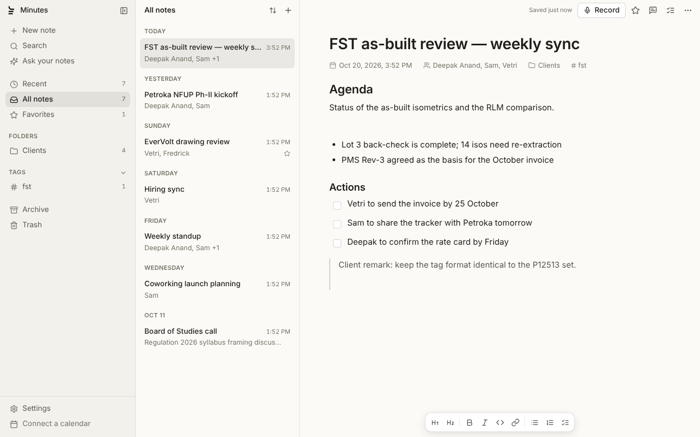
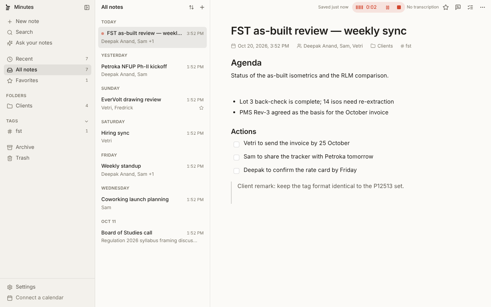
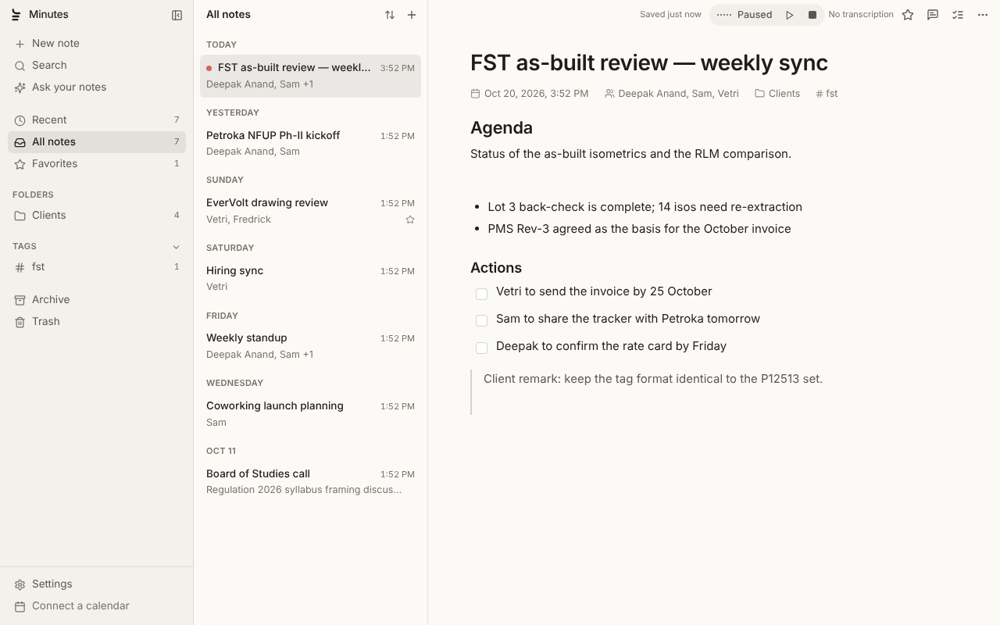
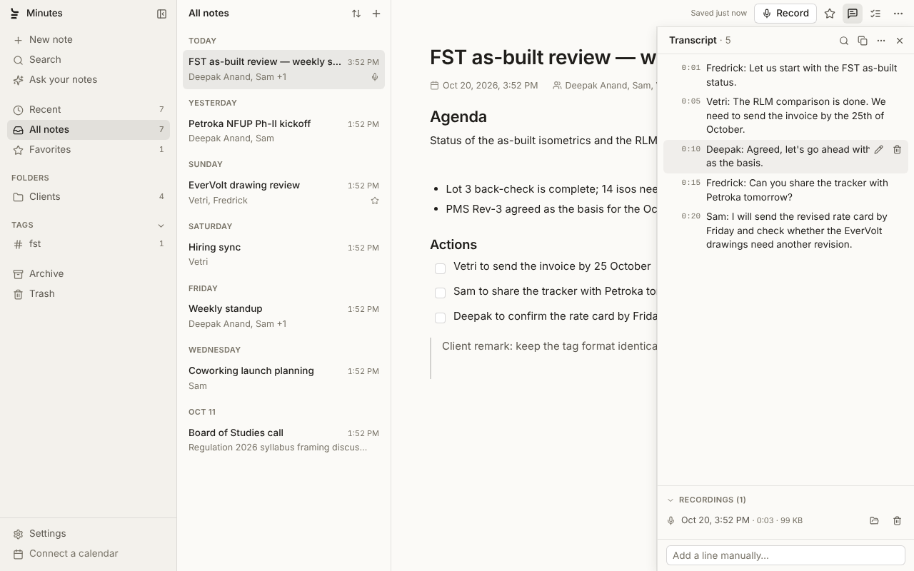
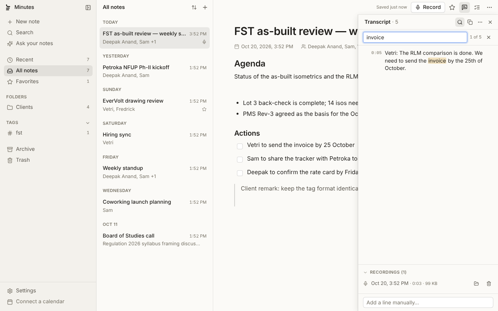
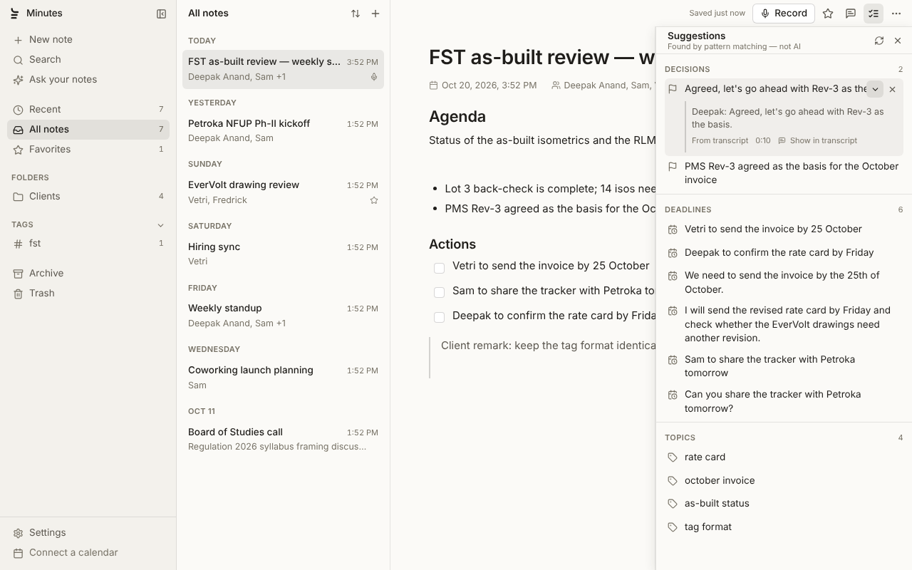
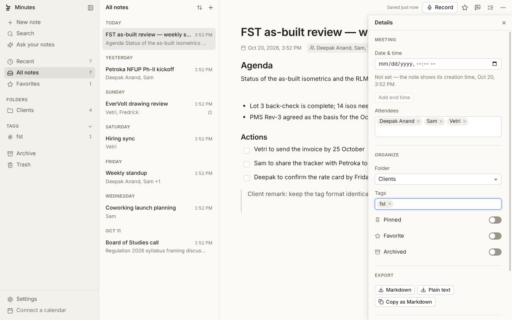
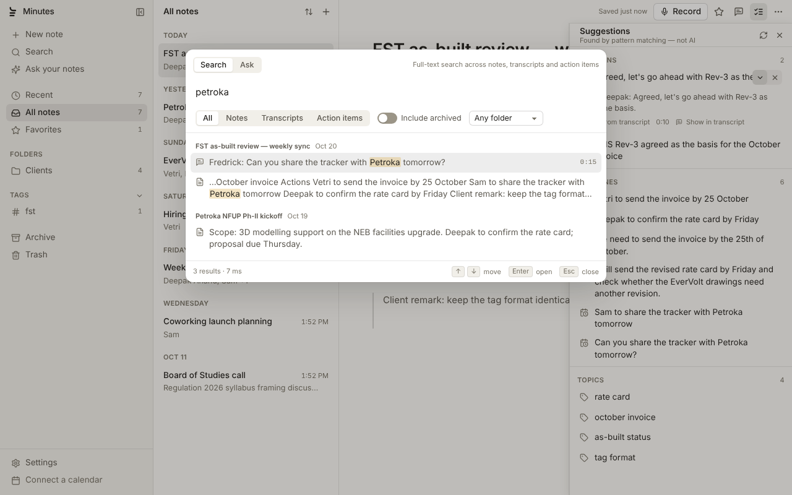
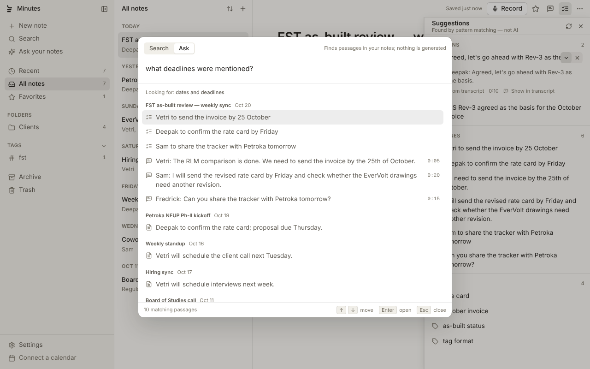
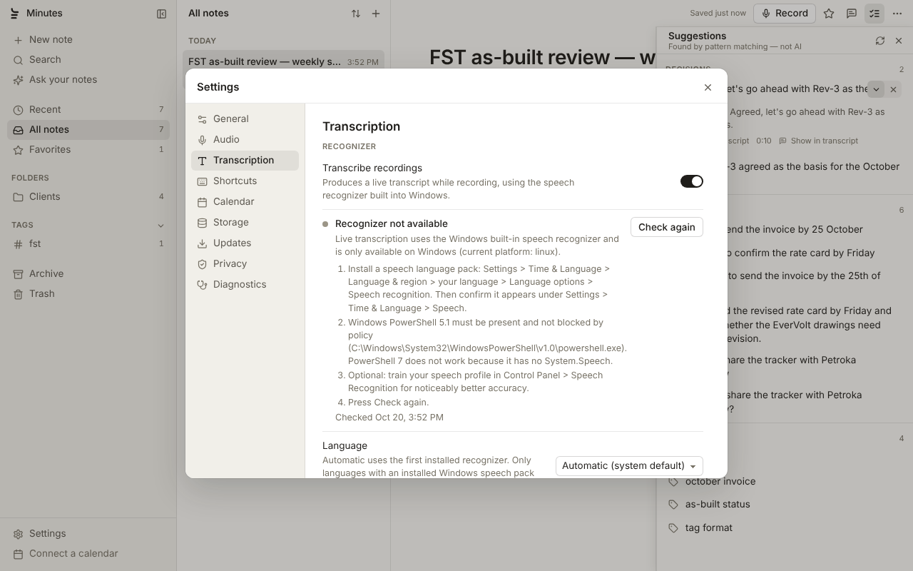
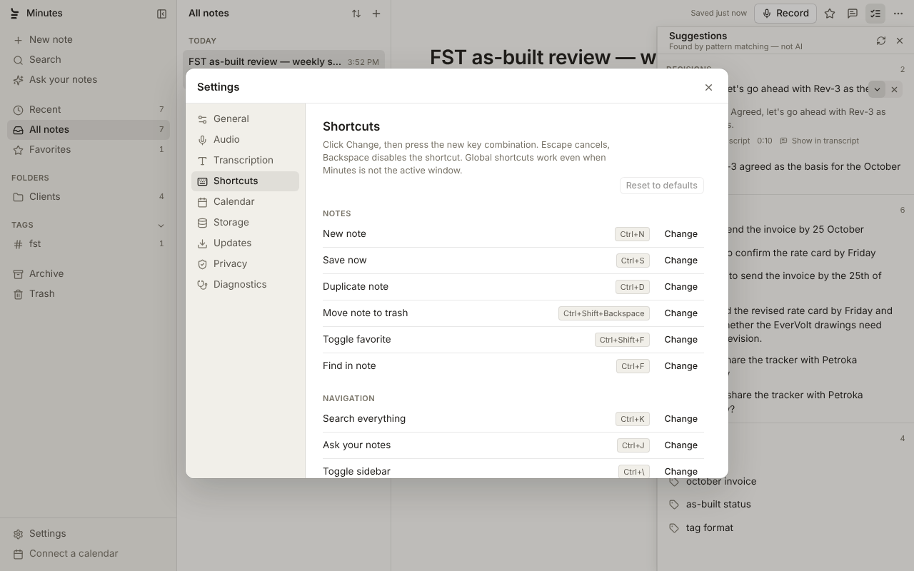
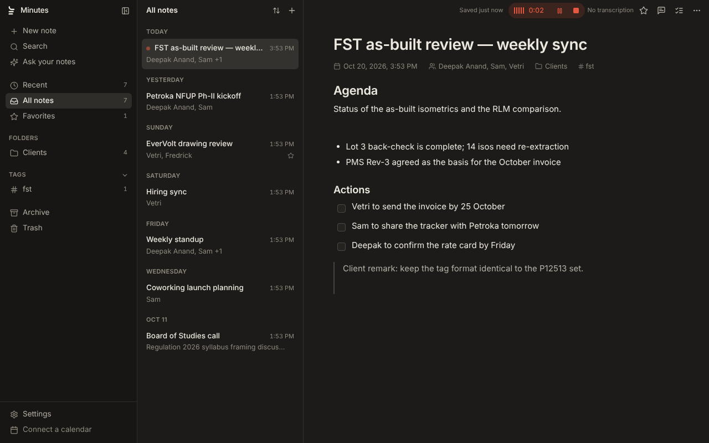

## Requirements

Notes, search, suggestions, calendar and export need nothing beyond the app
itself.

System-audio capture needs Windows 10 version 1903 or later (Chromium's WASAPI
loopback). Microphone-only recording works on any supported Windows version.

Transcription needs 64-bit Windows 10 or 11 on an x64 CPU (SSE4.2 at
minimum; AVX2 strongly recommended), at least 8 GB of RAM for the Lightweight
profile, 16 GB for Balanced or 32 GB for High accuracy, and one downloaded
model (31 MB for the smallest). No GPU is used. Full details, including what
each of three typical office machines gets, are in
`docs/hardware-requirements.md`.

The optional Windows speech recognizer engine needs Windows PowerShell 5.1
(`C:\Windows\System32\WindowsPowerShell\v1.0\powershell.exe`; PowerShell 7
lacks `System.Speech`) and a Windows speech recognition language pack.

## Install

Download the installer (`Minutes-Setup-<version>.exe`) from the GitHub
Releases page of this repository and run it. The build is not code-signed, so
Windows SmartScreen will show "Windows protected your PC"; choose "More info"
and then "Run anyway". The same prompt appears when an update installs.
Signing is the correct fix and is discussed in `docs/updates-and-release.md`.

## Development

Node 22 is required (the main process uses the built-in `node:sqlite`
module). Then:

```
npm install
npm run dev        # electron-vite dev server with hot reload
npm run build      # compile main, preload and renderer into out/
npm run typecheck  # tsc for the node and web projects
npm test           # vitest unit tests (tests/unit) and integration tests (tests/integration; skipped without runtime + model)
npm run test:e2e   # builds, then runs Playwright with tests/e2e/playwright.config.ts
npm run dist:win   # electron-builder NSIS installer for Windows x64
npm run dist:dir   # unpacked build in release/ for local inspection
```

On a headless Linux machine the end-to-end suite needs a display server:
`npm run build && xvfb-run -a npx playwright test -c tests/e2e/playwright.config.ts`.
What the tests cover is in `docs/testing.md`.

Packaging is configured in `electron-builder.yml`: an NSIS installer for
Windows x64, per-user install, user data never removed on uninstall, output in
`release/` as `Minutes-Setup-<version>.exe` with `latest.yml` and a blockmap.
The `publish` block points at GitHub owner `freddyaltrin`, repo `minutes`
(github.com/freddyaltrin/minutes), where installed copies look for updates. `npm run dist:win` also works from
Linux with wine; see "Building the Windows installer on Linux" in
`docs/updates-and-release.md`.

## Architecture

Three Electron processes, wired by electron-vite.

The main process (`src/main`) owns everything with side effects: the SQLite
database (`node:sqlite` with WAL, foreign keys and FTS5 virtual tables kept in
sync inside the same transaction as the rows they index), the repositories in
`src/main/db`, and the services in `src/main/services`: `RecordingService`
(receives PCM from the renderer, writes WAV, chunks speech and feeds the live
transcription session), `TranscriptionService` and its parts under
`services/whisper` (`WhisperEngine` process host, `ModelManager`,
`ResourceManager`, profiles, hardware inspection, audio windowing and the
background job loop over `JobsRepo`), `SpeechChunker` and the optional
`SapiEngine` under `services/transcription`,
`CalendarService` (ICS fetch and parse), `ExportService`, `BackupService`
(`VACUUM INTO` snapshots, guarded restore with a safety copy and relaunch),
`ShortcutService` (application menu, `before-input-event` and
`globalShortcut`) and `UpdaterService` (electron-updater against GitHub
Releases, packaged Windows builds only).

The preload (`src/preload/index.ts`) exposes exactly one object,
`window.minutes`, typed as `MinutesApi` in `src/shared/api.ts`. Every method
maps to an `ipcMain.handle` channel named `namespace:method`; the handler in
`src/main/ipc/handlers.ts` checks the sender frame with `isTrustedSender` and
validates every argument with the small validator in `src/main/ipc/validate.ts`
before touching the database or file system. Events from main to the renderer
go through the fixed `EVENT_CHANNELS` list.

The renderer (`src/renderer/src`) is React 18 with CSS Modules and a small
store (`state/app-store.ts`, `state/actions.ts`). `lib/audio-capture.ts`
captures microphone and loopback audio through Web Audio (an inline
AudioWorklet with a ScriptProcessor fallback), downsamples to 16 kHz PCM16 and
pushes ~250 ms chunks to main. `lib/recording-session.ts` keeps the capture
alive while components mount and unmount. Conventions are in
`docs/renderer-conventions.md`.

Shared code (`src/shared`) holds the types, defaults, shortcut definitions, the
ICS parser and the text processing used by both sides: tokenizer and stemmer,
sentence splitting, date mention parsing, TextRank-style phrase extraction,
the suggestion extractor, the question classifier, transcript parsers and the
Markdown/text renderers.

## Data locations

| What | Where |
| --- | --- |
| Database (notes, transcripts, suggestions, calendar cache, settings) | `%APPDATA%\Minutes\data\minutes.sqlite` (plus `-wal`/`-shm` while open) |
| Kept recordings | `%APPDATA%\Minutes\recordings\<noteId>\<timestamp>-mic.wav` and `-system.wav` |
| Speech models | `%APPDATA%\Minutes\models\whisper\ggml-<id>.bin` (plus `.part` while downloading); kept across updates and reinstalls |
| Audio awaiting background transcription | `%APPDATA%\Minutes\pending-audio\<noteId>\` — chunk files a live session could not finish; deleted once their job completes |
| Backups | `%APPDATA%\Minutes\backups\minutes-backup-<timestamp>.sqlite` |
| Log | `%APPDATA%\Minutes\logs\minutes.log` (rotated to `.1` at 2 MB) |
| Temporary speech chunks | `%TEMP%\minutes\rec-<id>\`, each file deleted once transcribed; the folder is removed when the recording ends |
| whisper.cpp runtime | `<install dir>\resources\whisper\win-x64\` (part of the program, replaced by updates) |
| Exports (default save location) | `Documents\Minutes` |
| Installed program (per-user NSIS) | `%LOCALAPPDATA%\Programs\Minutes` |

Uninstalling leaves `%APPDATA%\Minutes` in place on purpose.

## Keyboard shortcuts

Defaults from `src/shared/defaults.ts`; all are rebindable in Settings >
Shortcuts. "Global" shortcuts work while another application is focused.

| Action | Shortcut | Scope |
| --- | --- | --- |
| New note | Ctrl+N | App |
| Save now | Ctrl+S | App |
| Duplicate note | Ctrl+D | App |
| Move note to trash | Ctrl+Shift+Backspace | App |
| Toggle favorite | Ctrl+Shift+F | App |
| Find in note | Ctrl+F | App |
| Search everything | Ctrl+K | App |
| Ask your notes | Ctrl+J | App |
| Toggle sidebar | Ctrl+\ | App |
| Toggle transcript panel | Ctrl+T | App |
| Next note | Ctrl+Down | App |
| Previous note | Ctrl+Up | App |
| Open settings | Ctrl+, | App |
| Start / stop recording | Ctrl+Shift+R | Global |
| Pause / resume recording | Ctrl+Shift+P | App |

Export, keyboard-shortcut help, update check and About are available from the
menu bar without default accelerators.

## Privacy

Nothing is uploaded and there is no telemetry, analytics or crash reporting.
The log file stays on disk. The network is used only to download a speech
model you asked for, for ICS feeds you add and for the optional update check;
with a model installed, no feeds and automatic checks off, the app makes no
requests at all. Audio is processed on the machine by the bundled whisper.cpp
worker, which talks to the app over a random port bound to 127.0.0.1;
temporary chunk files are deleted once transcribed. Data is not encrypted at
rest; the Windows user account is the boundary. See `docs/security.md`.

## License

MIT. Copyright Dexterity Design Services Pvt. Ltd.

## Further reading

- `docs/reference-analysis.md` — what was observed about Granola and how each element maps to Minutes
- `docs/transcription.md` — the whisper.cpp pipeline, resource manager, model manager, runtime and status labels
- `docs/hardware-requirements.md` — minimum hardware, memory per profile, the three target machines
- `docs/models.md` — the model catalog, sizes, digests and memory figures
- `docs/benchmarks.md` — measured speed and memory per model and machine
- `docs/limitations.md` — known limitations, stated plainly
- `docs/security.md` — what the app enforces and what it does not
- `docs/testing.md` — unit tests, end-to-end status, manual on-device checklist
- `docs/updates-and-release.md` — updater behaviour, release steps, code signing
- `docs/brand.md` — the mark, icon and palette
- `docs/renderer-conventions.md` — rules for renderer code
